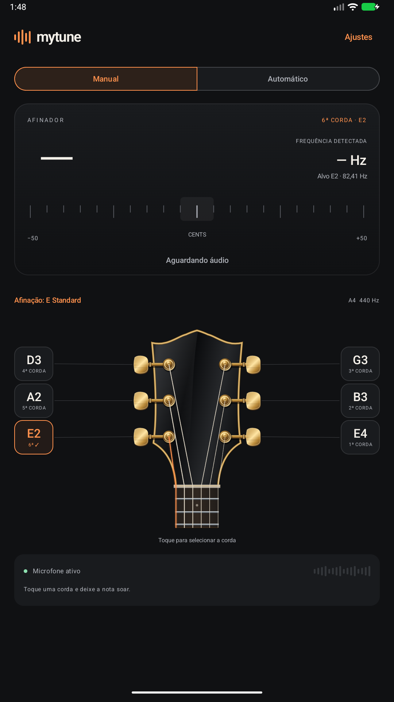
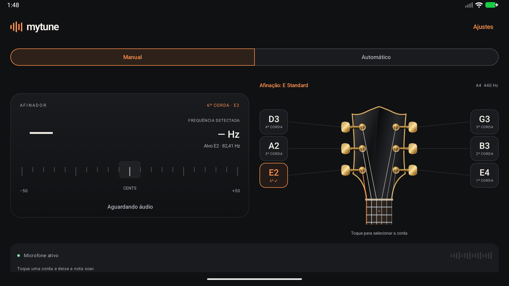

# MyTune


Afinador de guitarra Android nativo, offline, em Kotlin e Jetpack Compose. A **Release 1.0.0 é o lançamento inicial do aplicativo** e reúne todo o trabalho de precisão, afinação automática, afinações personalizadas e experiência visual.

O microfone fornece PCM real ao algoritmo YIN. O app funciona sem cadastro, backend, acesso à rede ou gravação de áudio em arquivos.

## Baixar o APK

[**Baixar MyTune 1.0.0 para Android**](https://github.com/FernandoPestillo/MyTune/releases/download/v1.0.0/MyTune-v1.0.0-debug.apk)

APK de testes (debug), assinado com chave de desenvolvimento, compatível com Android **8.0 / API 26** ou superior. Baixe o arquivo no aparelho, abra-o para instalar e conceda acesso ao microfone ao iniciar o afinador.

O APK corresponde ao código da `main`. Notas e SHA-256 estão na [Release 1.0.0 — lançamento inicial](https://github.com/FernandoPestillo/MyTune/releases/tag/v1.0.0).

## Prévia do App

Capturas atualizadas da Release **1.0.0**, feitas na Activity real em retrato e paisagem. As telas mostram E Standard, modo Manual e a sexta corda E2 selecionada, aguardando áudio.

### Modo retrato



### Modo paisagem



## Recursos da versão inicial

- **Precisão e estabilidade:** captura PCM real, YIN, filtros e rejeição de ruído/harmônicos, confirmação temporal, retenção breve e histerese da indicação de afinação.
- **Afinação manual e automática:** seleção das seis cordas, identificação automática da corda tocada, nota/oitava detectadas, frequência, desvio em cents e indicação para apertar ou afrouxar.
- **Afinações alternativas:** E Standard, Drop D, Eb Standard, D Standard, Drop C, Open D, Open G, Open E e Open A, com A4 fixo em 440 Hz.
- **Biblioteca personalizada:** criar, editar, copiar e excluir afinações de seis cordas entre B1 e E5. Afinação ativa e personalizadas são restauradas ao reabrir o app.
- **Três modelos de headstock:** 3 + 3 preto com filete e ferragens douradas; 6 em linha de madeira clara e ferragens cromadas; invertido preto angular com ferragens escuras. Todos usam trajetos convencionais e seleção por identidade física.
- **Personalização:** temas Escuro, Claro e Sistema, feedback tátil, animação das cordas e preferências persistidas.
- **Interface adaptável:** retrato/paisagem, rolagem em pouco espaço, controles de pelo menos 48 dp e suporte a fontes ampliadas/redução de movimento.
- **Ciclo de vida e privacidade:** microfone apenas com a tela ativa, cancelamento e liberação ao pausar, recuperação de permissão/erros e processamento local em memória.

Os relatórios técnicos de [precisão](docs/PRECISAO.md), [seleção automática](docs/AFINACAO_AUTOMATICA.md), [afinações](docs/AFINACOES.md), [personalização](docs/EXPERIENCIA_VISUAL.md) e [headstocks](docs/HEADSTOCKS_CORRECAO_VISUAL.md) registram etapas da construção desta mesma versão inicial.

## Executar pelo código

Requisitos: Android Studio compatível com AGP 8.13, JDK **17**, Android SDK **36**, Build Tools 35 ou superior.

1. Abra esta pasta no Android Studio e aguarde a sincronização Gradle.
2. Configure o SDK em `local.properties` (`sdk.dir=/caminho/do/Android/sdk`) ou pela IDE. Esse arquivo é local e ignorado pelo Git.
3. Selecione um aparelho Android com microfone e execute a configuração `app`.
4. Conceda a permissão e escolha a afinação em “Afinação: …”. Em Manual, selecione uma corda; em Automático, toque uma corda aberta por vez e aguarde a confirmação.

Com `JAVA_HOME` apontando para JDK 17:

```sh
./gradlew :app:assembleDebug
adb install -r app/build/outputs/apk/debug/app-debug.apk
adb shell am start -n com.mytune/.MainActivity
```

A primeira compilação baixa dependências; o aplicativo instalado funciona offline.

## Estrutura

```text
app/src/main/java/com/mytune/
├── MainActivity.kt                    # permissão, ciclo de vida e composição
├── data/audio/
│   ├── AudioCaptureSource.kt          # contrato de buffers emprestados
│   ├── AudioBufferManager.kt          # buffer circular PCM
│   └── AudioCaptureManager.kt         # AudioRecord, fila limitada e liberação em finally
├── data/tuning/                      # DataStore tipado, serializer e repositório
├── domain/
│   ├── model/                         # afinações, cordas físicas, notas, modo e resultados
│   ├── tuning/                        # presets, validação, frequência/MIDI centralizados
│   └── audio/
│       ├── AudioProcessingConfig.kt   # configuração YIN, janela e hop
│       ├── PitchDetector.kt           # frequência, RMS, confiança, qualidade
│       ├── YinPitchDetector.kt        # YIN independente do Android
│       ├── GuitarStringClassifier.kt  # associação limitada em cents, sem alterar fundamental
│       ├── AutomaticStringSelector.kt # confirmação temporal e histerese de seleção
│       ├── PitchSmoother.kt           # mediana + média exponencial
│       └── TuningCalculator.kt        # MIDI, oitavas, cents, tolerância
├── diagnostics/AudioPerformanceMetrics.kt # métricas opt-in, sem PCM
├── presentation/
│   ├── TunerUiState.kt                # estado imutável
│   ├── DetectionPresentation.kt       # retenção, confirmação de mudanças e histerese
│   └── TunerViewModel.kt              # StateFlow e orquestração
└── ui/
    ├── components/                    # guitarra, cordas, nota, escala, nível
    ├── screens/TunerScreen.kt         # composição responsiva
    └── theme/Theme.kt                 # Material 3 personalizado
```

## Decisões técnicas

**Afinações:** `GuitarTuning` fornece as seis referências atuais; a identidade da corda é seu número físico, independentemente do MIDI. `PitchFrequencyCalculator` centraliza A4=440 Hz. Presets são somente domínio; o arquivo DataStore 1.2.1 guarda ID ativo e personalizadas validadas. Registros inválidos são isolados/preservados e os demais recuperados, com aviso. Operações usam transações e revisão para evitar resultados antigos e corridas. Consulte [AFINACOES.md](docs/AFINACOES.md).

**Seleção automática:** `GuitarStringClassifier` usa as referências já existentes, ±150 cents, confiança ≥0,90 e qualidade/RMS válidos. `AutomaticStringSelector` exige ≥120 ms e ≥2 leituras, contadas com intervalo mínimo de 40 ms; na cadência atual normalmente são quatro janelas. Uma candidata conflitante não troca o alvo nem renova a retenção. Duas ou mais cordas dentro da banda são ambíguas, inclusive uníssono; o modo Manual resolve a escolha física. Saltos de oitava plausíveis exigem 180 ms. Não há correção arbitrária de frequência para caber numa corda. Alvo e resultado mudam juntos após confirmação, com reset dos filtros do alvo anterior. No automático, leituras retidas/ambíguas não mostram orientação atual; o destaque some após 1800 ms. Voltar ao Manual pelo controle restaura a última escolha manual; tocar na guitarra retorna a Manual com a corda tocada.

**Captura:** PCM mono de 16 bits, tentativa inicial em 44.100 Hz e fallback em 48.000 Hz. `UNPROCESSED` é usado quando o dispositivo declara suporte; se falhar, há tentativa com `VOICE_RECOGNITION`. As amostras são normalizadas em memória, sem persistência. Leituras não bloqueantes com espera cooperativa de 5 ms permitem cancelar a captura sem depender do desbloqueio de uma leitura nativa. Um mutex impede sobreposição de gravadores em pausas e retomadas rápidas.

**Análise:** janela de 4.096 amostras (~93 ms a 44,1 kHz) e passo de 2.048 (~46 ms). Isso cobre mais de sete períodos de E2 e limita a atualização a ~21,5 Hz (~23,4 Hz a 48 kHz). YIN utiliza diferença temporal, normalização cumulativa, primeiro mínimo abaixo de 0,15 e interpolação parabólica. Faixa: 55–1.100 Hz; RMS mínimo: 0,0025; confiança mínima: 0,90. Os buffers PCM, a janela e a área de trabalho do detector são reutilizados. Captura executa em `Dispatchers.IO` e análise em um worker `Dispatchers.Default`, fora da UI. Um buffer circular e três janelas reutilizáveis alimentam uma fila de uma janela; sob sobrecarga a mais antiga é descartada. Cada callback termina antes de seu buffer ser reutilizado. O processamento inclui FIR curto (~primeiro zero em 5 kHz), compensação da amplitude entre períodos, verificação de múltiplos de período com evidência do sinal e cálculo antecipadamente encerrado dos lags. `YinConfig` centraliza os parâmetros; o escore de confiança não é uma probabilidade.

**Estabilidade:** `DetectionStabilizer` separa o último buffer recebido da leitura apresentada. Silêncio, baixa confiança e buffers inválidos preservam nota, Hz, cents e orientação por 1.200 ms desde a última leitura aceita. De 1.200 a 1.800 ms, a leitura fica atenuada, perde o verde e recebe “Última leitura · Sem atualização”; aos 1.800 ms, retorna à espera. Um único job vinculado à captura verifica o prazo a cada 50 ms usando `SystemClock.elapsedRealtime()`, mesmo sem novos buffers. Pausa, perda de permissão, erro e término da captura limpam o resultado imediatamente.

A mediana de três leituras e EMA de fator 0,55 foram preservadas, agora calculadas na escala logarítmica de cents. Mudanças de nota/oitava e saltos maiores que 80 cents exigem duas leituras consecutivas e reiniciam o filtro, evitando interpolar notas diferentes. A histerese entra em “Afinada” em ±5 cents e sai além de ±7 cents; a leitura bruta também precisa respeitar essa faixa e o MIDI do alvo. Trocar de corda limpa retenção, suavização e histerese sem reiniciar o microfone; um buffer em processamento durante a troca é descartado.

Os tempos, tolerâncias, confiança mínima e confirmação de mudanças podem ser ajustados em `DetectionStabilityConfig`, injetável no ViewModel. O fator EMA também é configurável; a janela da mediana permanece em três. A janela de áudio e o hop estão em `AudioProcessingConfig`. O processamento mantém seu passo de ~21–23 Hz; o relógio de expiração não publica estados idênticos no StateFlow.

**Layout:** a orientação reserva o espaço da maior mensagem possível, medido na largura e escala de fonte atuais. Nota/oitava usam uma linha estável; Hz e cents usam números tabulares, precisão fixa e campos com alinhamento constante. Em pouco espaço ou fonte ampliada, nota e frequência ficam empilhadas. As animações alteram apenas cor, opacidade e ponteiro, preservando as dimensões do painel e a posição da guitarra.

**Nota versus alvo:** a nota é calculada por `69 + 12 × log2(f/440)`, e os cents por `1200 × log2(f/alvo)`. Outra nota ou oitava é mostrada como detectada e recebe o status de incompatibilidade, acompanhado da direção para apertar ou afrouxar. Por exemplo, 80 Hz fica a −51,32 cents de E2 e já é classificado como D♯2; a orientação continua sendo “Aperte a corda”, sem inventar E2 ou indicar afinação correta. O alvo nunca é usado para inventar uma detecção ou corrigir artificialmente a oitava.

**Dependências fixadas:** Kotlin/Compose Compiler 2.3.21, AGP 8.13.2, Gradle 8.14.3, Compose BOM 2026.04.01, Material 3, Activity Compose 1.11.0, Lifecycle 2.9.4, Coroutines 1.10.2 e JUnit 4.13.2. Não há biblioteca externa de DSP nem framework de injeção adicional. DataStore tipado 1.2.1 persiste as afinações e preferências locais.

Referências oficiais: [compatibilidade do AGP](https://developer.android.com/build/releases/agp-8-13-0-release-notes), [Compose BOM](https://developer.android.com/develop/ui/compose/bom), [AudioRecord](https://developer.android.com/reference/android/media/AudioRecord) e [fontes sem processamento](https://developer.android.com/media/platform/mediarecorder).

Os testes usam Espresso 3.7.0 explicitamente para evitar a reflexão de `InputManager` incompatível com Android 16 existente na dependência transitiva antiga de Compose. A correção consta nas [notas oficiais do AndroidX Test](https://developer.android.com/jetpack/androidx/releases/test#espresso-3.7.0).

## Testes

```sh
./gradlew :app:testDebugUnitTest :app:lintDebug :app:assembleDebug
# Com emulador ou aparelho conectado e desbloqueado:
./gradlew :app:connectedDebugAndroidTest
```

Os testes unitários exercitam as seis frequências nas duas taxas de amostragem, harmônicos dominantes, buffers sucessivos com continuidade de fase, ruído, silêncio, DC, baixa amplitude, rejeição por confiança, outras notas e oitavas, cálculo de cents, suavização, retenção/expiração com relógio virtual, histerese, rejeição de saltos isolados, seleção durante o processamento, cancelamento, retomada e recuperação de permissão/erro. Os testes instrumentados verificam as seis seleções, a independência entre nota e alvo e as posições dos componentes ao alternar leituras, silêncio e mensagens em retrato, paisagem e tela pequena com fonte ampliada. Um teste adicional abre o `AudioRecord` real, recebe buffers PCM, cancela e reabre a captura.

A suíte de afinações inclui testes dos nove presets, personalização/validação, classificação dinâmica, persistência/reabertura/concorrência/corrupção e C2/D2/Eb2/E2. Resultados e limites estão em [AFINACOES.md](docs/AFINACOES.md), o plano físico em [TESTES_AFINACOES.md](docs/TESTES_AFINACOES.md), e snapshots em `docs/measurements/afinacoes/`.

Os sinais sintéticos e fontes de teste existem apenas nos source sets de testes; não integram a captura de produção. A suíte de seleção automática cobre classificação das seis cordas, sete desafinações, confirmação temporal, sinais inválidos/ambíguos, alternâncias, retenção e UI com os dois modos. Consulte [AFINACAO_AUTOMATICA.md](docs/AFINACAO_AUTOMATICA.md), [TESTES_AFINACAO_AUTOMATICA.md](docs/TESTES_AFINACAO_AUTOMATICA.md) e os resultados em `docs/measurements/afinacao_automatica/`. Consulte [PRECISAO.md](docs/PRECISAO.md) para diagnóstico, resultados antes/depois, parâmetros, métricas e comandos reproduzíveis. O roteiro físico está em [TESTES_PRECISAO.md](docs/TESTES_PRECISAO.md). [VALIDATION.md](docs/VALIDATION.md) conserva o histórico da primeira etapa de desenvolvimento. O corpus/benchmark gera CSVs em `app/build/reports/precision/`; os snapshots desta implementação ficam em `docs/measurements/precisao/`.

## Limitações

No automático, uma corda muito desafinada ou uma nota presa que coincida com a frequência de outra corda aberta não pode ser identificada fisicamente apenas pelo fundamental. Sinais fora das faixas são rejeitados; o modo Manual continua disponível.

O detector é monofônico: acordes, várias cordas soando, ruído periódico e harmônicos com fundamental ausente ou muito fraca podem produzir leituras incorretas. A confiança do YIN mede periodicidade e não identifica a origem do som. RMS e limiares estão centralizados em `YinConfig` e precisam de avaliação acústica em diferentes aparelhos; um sinal fraco pode exigir aproximar a guitarra ou um amplificador do microfone.

A validação definitiva de precisão, latência, fontes de áudio e comportamento com guitarras elétricas/acústicas exige **dispositivos físicos**. Não foi assumida validação acústica a partir de testes sintéticos ou de emulador. Android pode suspender ou silenciar o microfone por privacidade ou disputa com outro aplicativo; erros detectados são apresentados para nova tentativa. Conectar o instrumento por cabo/USB não possui configuração específica nesta versão.

## Evolução

A versão **1.0.0** é a primeira release e inclui todos os recursos implementados até o lançamento. Os números antes usados nos planos de desenvolvimento eram etapas internas, não releases anteriores. A validação acústica em aparelhos físicos permanece pendente. O [roadmap](docs/ROADMAP.md) separa o escopo inicial das possibilidades futuras.
